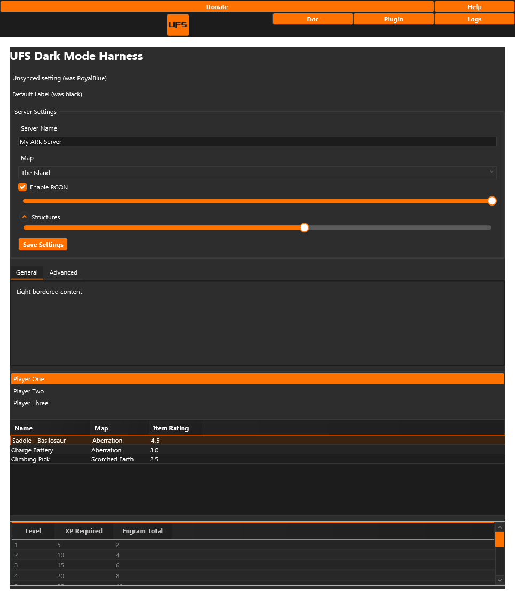

# UFS Dark Mode for ARK Server Manager

A dark theme plugin for ARK: Survival Evolved Server Manager (ASM) that applies the Unofficial Servers look to the Windows app.

[Unofficial Servers](https://unofficial-servers.com/) | [UFS ARK server list](https://unofficial-servers.com/servers/ark-survival-evolved)

**Version 1.0**



## Features

- UFS dark palette: `#1C1C1C` background, `#2D2D2D` panels, `#FF7200` accent
- Dark text boxes, combo boxes, sliders, check boxes, radio buttons and scroll bars
- Dark tables with orange headers, alternating rows and a subtle selected row
- All settings sections expand when a server page loads so the form is themed in one pass
- UFS logo button in the ASM header next to Discord, linking to the UFS ARK server list
- Dark title bars on Windows 10 and Windows 11
- Single standalone DLL, loaded through the normal ASM plugin system

## Install

1. Close ASM.
2. Download `ServerManager.Plugin.UfsDarkMode.dll` from [Releases](https://github.com/basjuh/ASM-dark-mode-plugin/releases).
3. Copy it into the `Plugins` folder inside your ASM install folder.
4. If Windows marked the file, right click it, open Properties, and choose Unblock.
5. Start ASM.

ASM loads plugins at startup. The first render can show a brief flash of the original light theme while ASM creates its windows and the plugin applies the palette.

## Compatibility

Built for ASM 1.1.447.1. Other versions may work if the plugin contract has not changed. This is an unofficial community plugin and is not affiliated with the ASM project.

## Build

Requirements:

- Windows
- .NET SDK 8 or newer
- A local ASM install containing `ServerManager.Plugin.Common.dll`

```powershell
dotnet build UfsDarkModePlugin.csproj -c Release -p:AsmInstallPath="C:\Program Files\ArkServerManager"
```

The output is `bin\Release\ServerManager.Plugin.UfsDarkMode.dll`.

`AsmInstallPath` defaults to `C:\Program Files\ArkServerManager`. You can also set the `ARK_SERVER_MANAGER` environment variable. The ASM contract DLL is not included in this repository.

## How it works

ASM loads plugin DLLs from its `Plugins` folder. This plugin implements `IPlugin` from `ServerManager.Plugin.Common`, waits for ASM windows, inserts the UFS theme into the local resource scope used by ASM controls, and applies the palette across the visual tree. It also injects the UFS header button and opens the settings sections.

No data is collected or sent anywhere. The only network action is opening the UFS ARK server list when the UFS header button is clicked.

## Links

- [Unofficial Servers](https://unofficial-servers.com/)
- [UFS ARK server list](https://unofficial-servers.com/servers/ark-survival-evolved)
- [ARK Server Manager releases](https://github.com/Bletch1971/ServerManagers)

## License

MIT. See [LICENSE](LICENSE).
